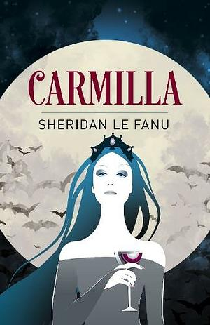

**Author**: Sheridan Le Fanu

**Format**: Paperback

_Carmilla_ is a nice short lesbian vampire story. I was particularly surprised by how lesbian some of the interactions got, though its mostly the main character being like uwu Carmilla's so pretty...... Also it's really funny that Carmilla _has_ to use permutations of her name as pseudonyms. I thought at first that "Marcilla" and "Millarca" were just le Fanu being really uncreative but no this is apparently a supernatural restriction on making up names. Can't wait to become a vampire and have to go by "Kys". 