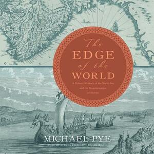

**Author**: Michael Pye

**Format**: Audiobook (Narrator: Steven Crossley)

_The Edge of the World_ is a relatively entry-level survey history of the North Sea region (especially the Low Countries and the British Isles). As the subtitle suggests, the book is focused primarily on being a 'cultural' / social history. This is fairly well-done at a high level; most chapters focus on a specific theme (e.g. sex/marriage, books/printing) and discuss various facets of the theme in Northern Europe over the course of medieval history. As is to be expected from such a wide scope and a relatively short book, Pye doesn't go into too much detail about any one theme, but the book is filled with interesting and fun case studies / anecdotes to help give colour to the rather straightforward overview.

Unfortunately, the focus on the "edge of the world" did not particularly feel like it justified itself - in general, the book functioned more as a general social history of medieval Western Europe that happened to draw upon anecdotes in more northern countries. The book was strongest in the first couple of chapters, where Pye discussed the concept of Northern Europe, its relatively limited perspective in Roman-era sources, and the social impact of the Vikings in particular on normal people's lives. Past that point, however, the book increasingly diverges from its premise - even the anecdotes star to draw more and more from central/southern Europe.