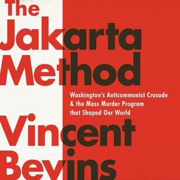

**Author**: Vincent Bevins

**Format**: Audiobook (Narrator: Tim Paige)

_The Jakarta Method_ is a journalistic history of the US's funding of right-wing anti-communist groups in the Third World; as the title suggests, the book is primarily focused on the 1965 coup in Indonesia that installed Suharto, but about a third of the book details the right-wing military coup in Brazil at a similar time that overthrew Joao Goulart (many other US-backed coups get mentions throughout). The book highlights the surprisingly globalized nature of the anti-communist movement beyond simply the fact that the US was a primary backer - most memorably, the Brazilian right-wing was extremely aware of the 1965 Indonesian coup and drew directly upon it for inspiration, to the point that phrases along the lines of "we will Jakarta you" became widespread among the right (in graffiti and also in more public rhetoric). It becomes particularly easy to draw similarities to the development of right wing chud culture in the last like 3 years, though Bevins doesn't make this connection mostly because he wrote this book in 2020.

As mentioned, Bevins approaches the subject as a journalist would, meaning that much of the story is told through the lens of personal interviews that Bevins had with victims of these Jakarta-inspired anti-communist movements. This is the major selling point of the book, imo - every person's individual story is well-told and really helps to ground the almost comically violent events being recounted. In particular, one chapter of the book is solely devoted to a roughly day-by-day/week-by-week accounting of the anti-communist massacres in Indonesia in the months following the coup that is extremely harrowing and really drives home just how terrifying the reprisals must have been for ordinary people, even if they weren't particularly communist-friendly. 

_The Jakarta Method_ mostly falls short in the fact that it reads like baby's first vaguely left-wing book - there are a lot of pretty typical one-off statements about the American complicity in mass death that, for anyone that's been exposed to any left-wing literature on this time period, comes off as repetitive and not particularly relevant (a lot of wow did you know American political figures were sympathetic to Nazis????). I'm sure this all plausibly hits really hard if u were a 16-year-old recently jaded by liberal politics though.