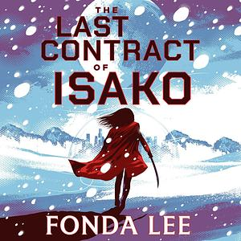

**Author**: Fonda Lee 

**Format**: Audiobook (Narrators: Mary Robinette Kowal, Dillon Sickels)

_The Last Contract of Isako_ is a dystopian scifi novel set on a newly (ish) settled planet. As your typical dystopian scifi novel in the year 2026, the setting is a capitalist hellscape where life centres around a central Corporation - "wars" end in department mergers and layoffs, and the option to "resign" is offered to laid off workers wherein they voluntarily walk out of the protective airshield in exchange for societal honours and a substnatial inheritance. This is all of course justified by a scarcity of resources etc. and a lack of contact with Earth, though there are still remnants of Earth culture (e.g. Christianity still exists, as a minor religion). In this setting, Isako is a "tier A" contractor, which means she basically serves as a combination highly-skilled bodyguard/extraordinarly competent personal aide/secret agent/etc. for her client. She's also old and starting to be washed up, which is mentioned in every other paragraph. She also constantly reminds the reader that the overriding concern of any contractor is to serve their client, with no other loyalties. Then suddenly her client resigns (remember this means literally forfeiting your life) without telling her, leaving her a "ronin" but for the fact that her contract was transferred to another client without her knowledge. She's asked to fulfill one last task for her new client before she resigns, hence the title. 

The setting of the novel does not end up being particularly interesting - the idea of the MegaCorporation (tm) being the primary mode of existence in a dystopian YA-adjacent scifi world is so overdone at this point and this iteration does not particularly bring much new to the table. In particular, none of the core societal inequities get resolved or are even addressed in any particularly meaningful way, which could be fine except that all of the systems are exposited in such a blunt way that the only way it'd feel worth it is if any of the issues actually got resolved somehow. It's not even clear that the author would support overthrowing the system - obviously the perspective of the book is Isako's, and is therefore extremely embedded in the system, but even within that perspective absolutely nothing hints at the idea that a better world could actually be created (again, despite the many mentions/centrality of e.g. labour unrest, terrorism, etc.). Even the personal growth Isako goes through is highly particularized; she has a little bit of personal growth in that she learns to accept that she can live D: as a freelancer D:, but that's about it. In that way, I suppose, it's a much more realistic, if not particularly interesting, take on the jaded old master becoming a revolutionary. 

All of this said, the book is well-written enough to be at least worth a read generically. The core detective mystery-esque arc of the plot is fun enough and keeps you hooked once it gets going. The action scenes are relatively uninspiring though.

ALSO ok a pretty key feature of this world is that there are artificial "synth" bodies that the rich people can put their brains into which is fine enough but then there's one kinda side/kinda main ish character who's the bodyguard of the Main Bad Guy and it's commented on that she's actually in the body that he originally commissioned for his ex-wife bombshell model or whatever and this is like a huge scandal and not allowed wow the tabloids are going insane. And this opens some interesting enough threads about wow he literally owns her body and like he saved her life but what a dilemma. BUT its revealed that she's a trans woman so now basically the only explicitly queer person in the book is a trans woman who's literally stealing someone else's body???? And the way that she's revealed to be trans is so clumsy she's literally half exploded on a medical table and the narration is like. wow. you can see so much organs, the remains of her torso, entrails, a penis, torn apart legs and its just like great thank you. I love identifying trans women by penis. Like idk maybe im not woke enough but i had to literally pause and rewind to be like did i hear that right. and then there's an awkward conversation (that at least is lampshaded as being really awkward in text) where someone is like well. you know. you already transitioned before so maybe that helped with the whole experience (of literally inhabiting someone else's body??) and she's like. i guess. why was no one else queer in this novel. why was it just her. is this for woke points??? is this woke??????? like its at most half a chapter where this is ever relevant which is vaguely appreciated but like ??????