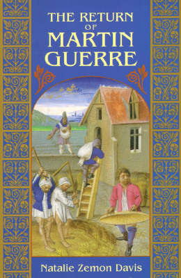

**Author**: Natalie Zemon Davis

**Format**: Ebook

_The Return of Martin Guerre_ is a classic microhistory that examines the extraordinarily weird legal case of Martin Guerre, a peasant living in southern France in the 1500s. A couple years into his marriage, Guerre abruptly abandoned his wife and son to go adventuring around Western Europe. A couple years later, a man shows up claiming to be Martin Guerre and lives in the town as Guerre for a couple years before Guerre's father eventually sues him for being an imposter. The resulting trial almost goes for the imposter, except that Guerre dramatically returns to prove that he was the true Martin Guerre. 

Davis recounts the story of Martin Guerre in a nice and short package that sheds a light on many different aspects of medieval French peasant life, in the manner you would expect from a microhistory and a historian of this calibre. I particularly appreciated the explicit effort that Davis makes to try and _actively_ reconstruct the lives of Martin Guerre, his wife, and others in the village. Even though, as Davis notes, much of the reconstruction must be conjecture, it's clear that whatever guesses must be made are well-supported. Most notably, Davis argues, pretty convincingly, that Guerre's wife, Bertrande, almost certainly had to have known that her "returned" husband wasn't who he said he was, and thus actively chose to help him keep up his guise until the real Martin Guerre returned. At the time, she was (luckily) generally considered to just a misguided woman(tm) and therefore not liable, but as Davis points out, such an argument definitely does not hold up under modern standards. Amusingly, Davis seems to imply that Bertrande actively liked the faux Martin Guerre more than the real one, even beyond the fact that a functionally single but unmarryable woman in medieval France was a real detriment.

Would definitely recommend to anyone interested even vaguely in this time period, it's so short that it's quite easy to just pick up and burn through. 